# Citation X Suite for FlyWithLua (X-Plane 12)

Four FlyWithLua NG+ scripts for the Laminar Research Cessna Citation X (C750), plus a
standalone landing-performance scorer.

> ⚠️ **WORK IN PROGRESS** — v3.0 is being verified in-sim. What has never been seen in
> X-Plane yet: the restored AviTab cockpit screen (2026-10-31), callout timing in flight,
> the 16-row black realism panel, and the 8K dark cockpit textures under the simulator's
> texture cap. Every script passes the offline harnesses (see *Development and validation*);
> the remaining items are recorded in `CONTEXT.md`.

**Version 3.0 has no keyboard layer.** The suite reads exactly one pilot input — the mouse
wheel — and everything else is a panel, a diagnostic or a command you can bind yourself.

## Screenshots

### The panels (rendered offline from the actual draw calls)

The suite's on-screen surfaces: the Master Suite hub and the realism pack panel at load,
plus the EFB, cabin-ops and QRH panels opened from the hub. There is no telemetry HUD —
airspeed, altitude, heading, Mach, G, fuel flow, electrics, fuel and anti-ice stay on the
aircraft's own PFD, EICAS and synoptics.

| Load view (hub + realism panel) | Hub | Realism panel |
| --- | --- | --- |
| [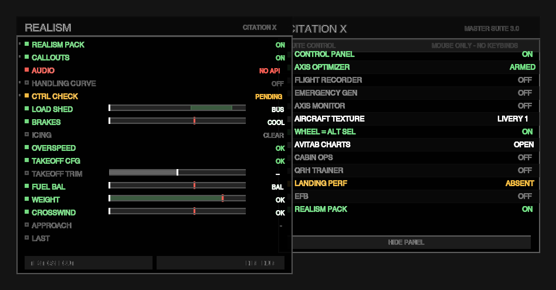](docs/img/panels/load.png) | [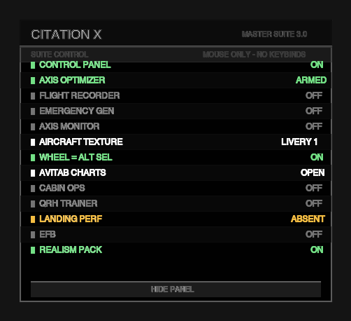](docs/img/panels/hub.png) | [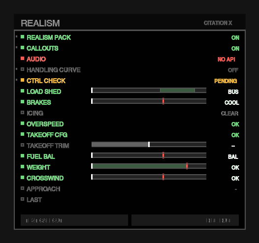](docs/img/panels/realism.png) |

| EFB (PERF) | Cabin ops | QRH trainer |
| --- | --- | --- |
| [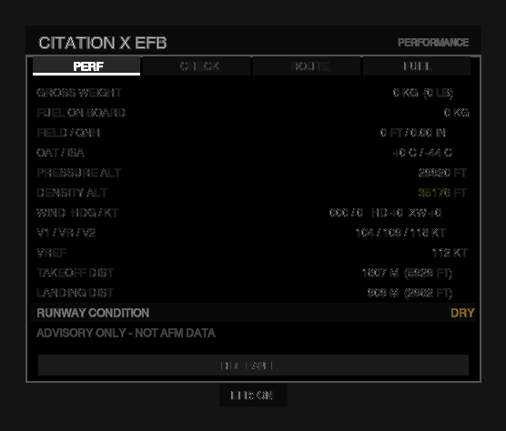](docs/img/panels/efb.png) | [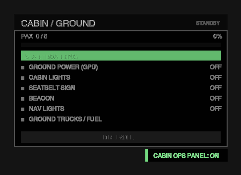](docs/img/panels/cabin.png) | [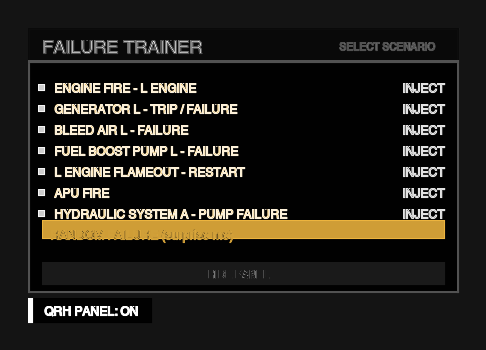](docs/img/panels/qrh.png) |

### Upscaled cockpit textures (work in progress)

The cockpit panel was shipped only as a compressed 4K DXT1 texture; the 8K Cascade 3 panel
was on disk but unused. The panel is now an **8192² PNG** (X-Plane's cockpit-object texture is
exempt from compression) with an 8192² DXT5 fallback, and the interior atlases run 8192² /
4096². Before/after pairs:

| Stock (4K DXT1) | Upscaled (8K, current) |
| --- | --- |
| [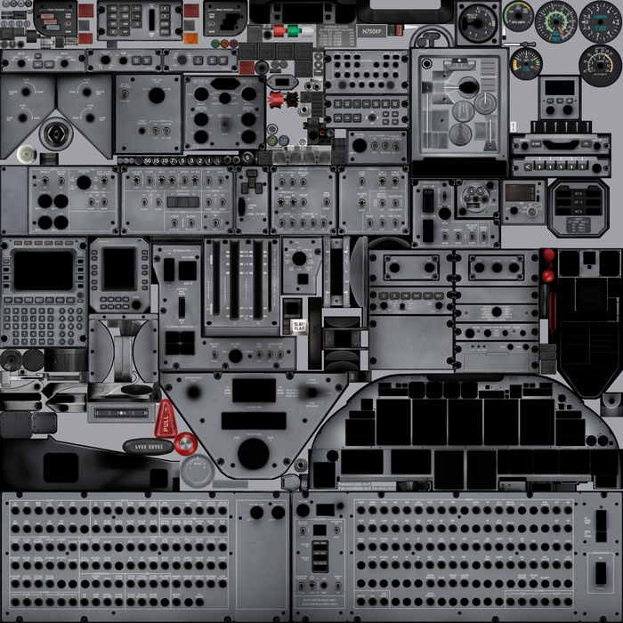](docs/img/textures/panel_full_stock.png) | [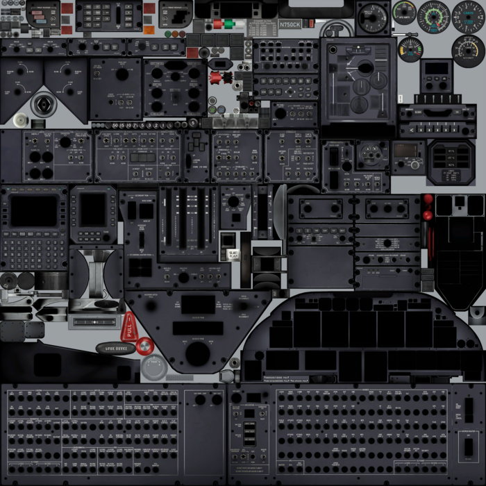](docs/img/textures/panel_full_dark.png) |
| [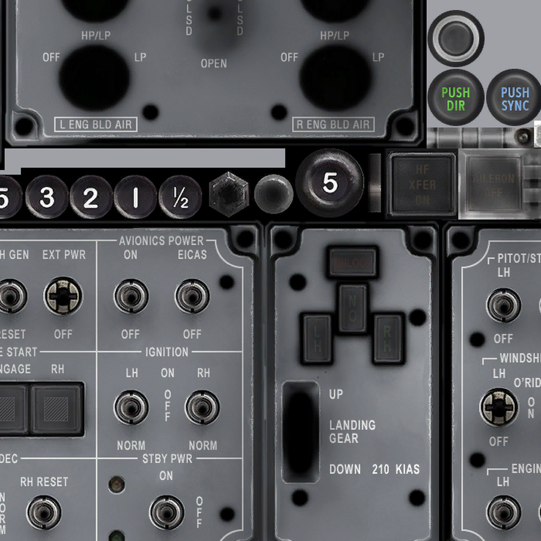](docs/img/textures/panel_gear_stock.png) | [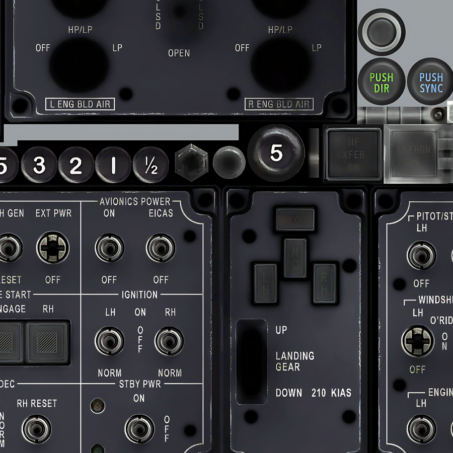](docs/img/textures/panel_gear_dark.png) |
| [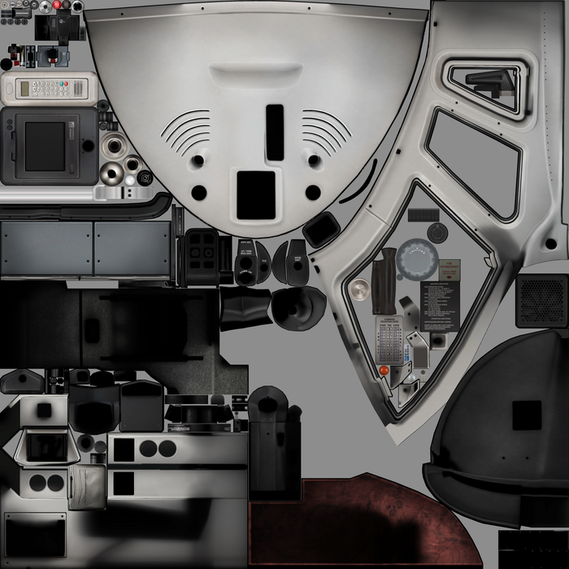](docs/img/textures/int_overall_stock.png) | [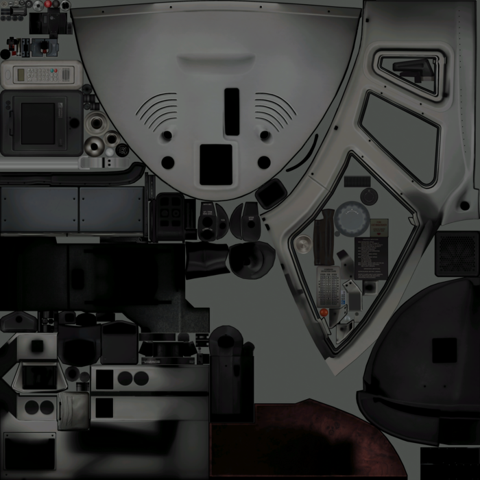](docs/img/textures/int_overall_new.png) |
| [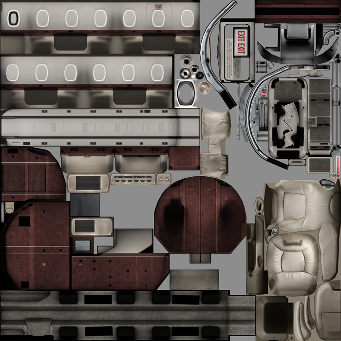](docs/img/textures/int_cabin_stock.png) | [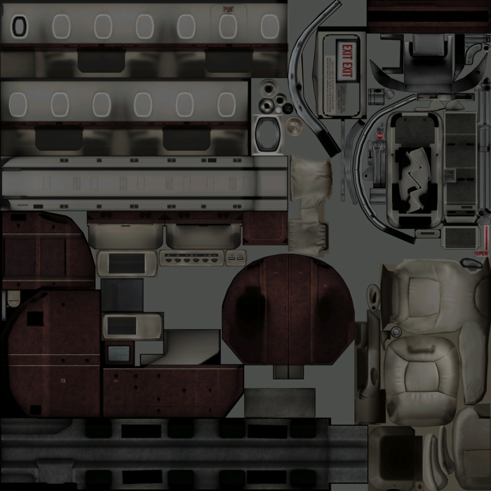](docs/img/textures/int_cabin_new.png) |
| [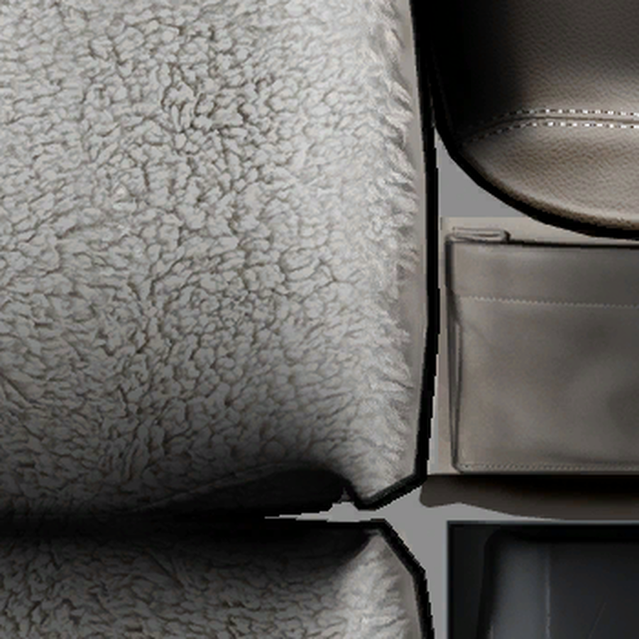](docs/img/textures/seat_crop_stock.png) | [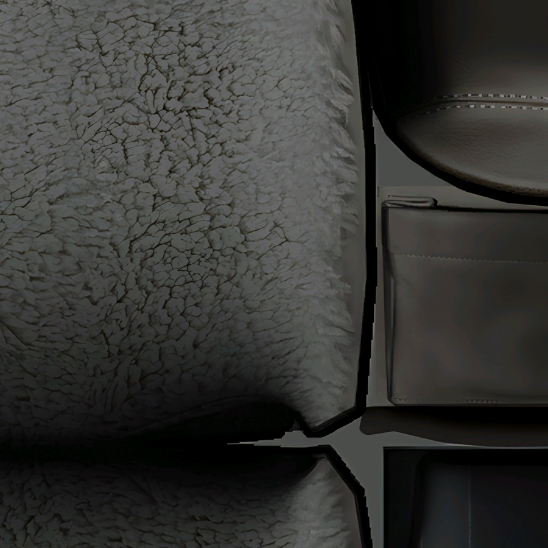](docs/img/textures/seat_crop_new.png) |

The dark panel is a deliberate finish change, not just a resolution upgrade; the light 8K
transplant is backed up. **The textures themselves live in the aircraft mod**
(`Aircraft/Cessna Citation X_mods/`), outside this repo — the images above are captures.

## Scripts

| File | Purpose |
| --- | --- |
| `Scripts/CitationX_MasterSuite.lua` | The hub. Axis optimizer (pitch/roll deadzone, expo, smoothing), 1 Hz flight recorder CSV, simulated bleed-air/pressurization emergency, opt-in axis monitor, aircraft texture cycler (X-Plane's own next/previous livery), AviTab app shortcuts, and the draggable control panel. The mouse wheel moves ALT SEL (main wheel) and the heading bug (thumbwheel); taxi and landing lights are published as commands. No keystrokes, no button map, no telemetry HUD. |
| `Scripts/CitationX_FailureTrainer.lua` | QRH-style failure scenarios (engine fire, generator trip, bleed air, boost pump, flameout, APU fire, hydraulics) with checklists that self-check against the aircraft's own datarefs. |
| `Scripts/CitationX_CabinOps.lua` | Boarding / ground-power / cabin-lights flow with a clickable panel, passenger progress and automatic phase handling. |
| `Scripts/CitationX_EFB.lua` | Electronic flight bag panel: PERF (density altitude, wind components, V1/VR/V2/Vref, takeoff and landing distance by runway condition), CHECK (your own Xchecklist `clist.txt`, read live from the same file the plugin loads), ROUTE (flight-plan maker with an on-screen keypad that writes an X-Plane `.fms`) and FUEL (trip/contingency/alternate/reserve/endurance). Advisory data only. |
| `Scripts/CitationX_Realism.lua` | Realism pack: one black panel of LEDs and bar gauges (trim band, fuel balance, weight against MTOW/MLW, crosswind against the demonstrated limit, brake energy, bus voltage) with clickable toggles. Behind it: audio callouts (V1, rotate, positive rate, gear up/down, 1000/500/100, minimums, stable/unstable, fuel imbalance, crosswind, overweight) on FlyWithLua's FMOD master bus; flight-controls check; takeoff trim/flap gate; fuel-balance monitor; MTOW/MLW limits; electrical load manager that drives the aircraft's own LOAD SHED switch; brake-energy monitor that runs the brake fan; Vmo/Mmo overspeed, takeoff-config, flap/gear overspeed, anti-ice-off, icing, cabin-altitude and crosswind advisories (each also raises a 2 s toast). |
| `Scripts/LandingPerformance.lua` | Standalone landing scoring and debrief card (third-party, untracked in git). |

## Control panel

**Two panels are on screen at load: the black realism panel and the Master Suite hub.**
The suite registers no keystroke handler and no controller-button map, so every key and every
button belongs to X-Plane's own profiles. It reads exactly one pilot input — the mouse wheel —
and only to move the two autopilot selectors:

| Mouse | Action |
| --- | --- |
| main wheel forward / back | ALT SEL up / down (100 ft per notch) |
| thumbwheel forward / back | heading bug right / left (1° per notch) |
| middle click | *bind `CitationXSuite/taxi_light_toggle` in your mouse driver* |
| gesture | *bind `CitationXSuite/landing_lights_toggle` in your mouse driver* |

X-Plane reports which wheel moved in `MOUSE_WHEEL_NUMBER`; if your mouse enumerates them the
other way round run `CitationXSuite/wheel_map_swap`, and `CitationXSuite/wheel_report` logs what
the last notch reported. The **WHEEL = ALT SEL** row switches the wheel off entirely, leaving
the view zoom with X-Plane.

FlyWithLua cannot see individual mouse buttons, so middle click and gestures cannot be captured
by the suite. Both actions exist as real X-Plane commands — point the mouse driver (Logi
Options+, SteerMouse, …) at `CitationXSuite/taxi_light_toggle` and
`CitationXSuite/landing_lights_toggle`, or bind them to any controller button in X-Plane. If
your driver can only send a keystroke, bind that keystroke **in X-Plane** to the command; the
suite never reads a key.

All panels share the realism panel's language: black body, grey 1 px border, white Helvetica 18
title, grey 10 px sub-header, 12 px rows, 22 px row pitch and a 34 px footer with a **HIDE
PANEL** button. **Drag any panel by its header** to move it; the position is kept for the
session. The hub starts at the top-left, the realism panel beside it.

The hub lists every subsystem with a live state. Click a row to toggle it.
The same toggles are available as X-Plane commands (`CitationXSuite/toggle_<key>`) and as
FlyWithLua macro menu entries.

The MasterSuite panel is the only surface *it* draws. There is no telemetry HUD and no C750
systems readback: the aircraft's PFD, EICAS and synoptics already show airspeed, altitude,
heading, Mach, G, fuel flow, electrics, fuel and anti-ice, so duplicating them on screen adds
nothing.

| Row | Key | What it toggles |
| --- | --- | --- |
| CONTROL PANEL | `status` | This panel itself |
| AXIS OPTIMIZER | `axis` | Custom pitch/roll response curve |
| FLIGHT RECORDER | `log` | 1 Hz CSV recorder |
| EMERGENCY GEN | `emerg` | Bleed-air / pressurization emergency triggers |
| AXIS MONITOR | `axmon` | Raw axis overlay |
| AIRCRAFT TEXTURE | `texture` | Next installed livery (X-Plane reloads the art) |
| WHEEL = ALT SEL | `wheel` | Mouse wheel drives the altitude selector |
| AVITAB CHARTS | `avitab` | Opens AviTab's charts app |
| CABIN OPS | `cabin` | `CitationX_CabinOps` panel |
| QRH TRAINER | `qrh` | `CitationX_FailureTrainer` panel |
| LANDING PERF | `landperf` | `LandingPerformance` result card |
| EFB | `efb` | `CitationX_EFB` panel (PERF / CHECK / ROUTE / FUEL) |
| REALISM PACK | `realism` | `CitationX_Realism` callouts and load manager |

The sibling rows are nil-guarded: if that script is not installed the row shows
`ABSENT` and clicking it does nothing.

### AviTab

[AviTab](https://github.com/fpw/avitab) 0.7.1 is installed in
`Resources/plugins/AviTab/`. The suite only forwards to AviTab's own API — it never draws or
replaces it:

| Command | Effect |
| --- | --- |
| `CitationXSuite/avitab_charts` | AviTab → Charts |
| `CitationXSuite/avitab_maps` | AviTab → Maps |
| `CitationXSuite/avitab_routes` | AviTab → Routes |
| `CitationXSuite/avitab_airports` | AviTab → Airports |
| `CitationXSuite/avitab_toggle` | show/hide the tablet |
| `CitationXSuite/avitab_recentre` | recentre the map |
| `CitationXSuite/avitab_zoom_in` / `_out` | map zoom |

The in-cockpit AviTab screen (the iPad on the console arm, restored 2026-10-31) is part of the
aircraft mod `Aircraft/Cessna Citation X_mods/`: `AviTab.json` carries the corrected 1024-space
panel rect and the screen quad lives in `cockpit_panel_interactive.obj`. See `CONTEXT.md` §16
and §33.

AviTab has no API to host or drive a third-party application, so **FlyCharts cannot be
controlled from AviTab**. FlyCharts is a separate Electron app that reads X-Plane over UDP
port 49000; run it beside the sim. What the two can share is data, not control: AviTab 0.7.1
publishes `avitab/map/latitude`, `avitab/map/longitude`, `avitab/map/zoom` and
`avitab/map/vertical_range`, and `CitationXSuite/avitab_report` logs them.

## Requirements

- X-Plane 12
- FlyWithLua NG+ 2.8 or newer (mac / win / lin build)
- Laminar Research Cessna Citation X (most features degrade gracefully in other aircraft)

## Install

Copy the `Scripts/CitationX_*.lua` files into:

```
X-Plane 12/Resources/plugins/FlyWithLua/Scripts/
```

Then **restart X-Plane** (or reload the scripts from the FlyWithLua menu). This
repository is designed to live directly inside that folder: git tracks only the first-party
suite, while the rest of the FlyWithLua install (binaries, Modules, Internals, Documentation)
stays untracked via `.gitignore`.

> **FlyWithLua 2.8.16 and older:** *Reload all Lua script files* can crash X-Plane while it
> tears down the realism pack's FMOD sounds. This install is on **2.8.20** (2026-10-23), which
> contains the upstream fix; if you ever roll the plugin back, quit and restart the sim after
> changing scripts instead of reloading.

## Configuration

- `CitationX_MasterSuite.lua` — `CONFIG` table: flight recorder, axis optimizer
  (`axis_optimizer_enabled`, `deadzone`, `curve_exponent`, `smoothing_factor`), emergency
  generator, the mouse wheel (`mouse_wheel_altitude`, `wheel_altitude_number`,
  `wheel_heading_number`, `alt_step_ft`, `hdg_step_deg`), texture cycling and the opt-in axis
  monitor. Panel layout lives in `SUITE_STYLE` (`row_h`, `header_h`, `footer_h`, `pad`, `x`/`top`).
- `CitationX_CabinOps.lua` — `CAB_CONFIG` (`row_h` controls row spacing).
- `CitationX_FailureTrainer.lua` — `TRAINER_CONFIG` (`row_h` controls row spacing).
- `CitationX_Realism.lua` — `REAL_CONFIG`: callout speeds (V1/Vr/Vref/Vfe/Vle), Vmo/Mmo,
  minima, load-shed threshold, brake-energy limits, icing window, anti-ice/cabin-altitude
  triggers, stabilised-approach gate, takeoff trim/flap gate (`to_flap_*`,
  `to_trim_tolerance`), fuel balance (`fuel_imbalance_lb`, `fuel_rearm_lb`,
  `fuel_imbalance_delay_s`), weight limits (`mtow_lb`, `mlw_lb`), crosswind
  (`crosswind_limit_kt`), handling curve (`handling_deadzone`, `handling_exponent`,
  `handling_smoothing`), control-check travel, `audio_backend` (`auto`/`fmod`/`wav`) and
  `toasts_enabled`.

## Bindable commands

```
CitationXSuite/toggle_status     CitationXSuite/toggle_axis     CitationXSuite/toggle_log
CitationXSuite/toggle_emerg      CitationXSuite/toggle_axmon    CitationXSuite/toggle_wheel
CitationXSuite/toggle_texture    CitationXSuite/toggle_cabin    CitationXSuite/toggle_qrh
CitationXSuite/toggle_landperf   CitationXSuite/toggle_efb      CitationXSuite/toggle_realism

CitationXSuite/texture_next      CitationXSuite/texture_prev
CitationXSuite/alt_sel_up        CitationXSuite/alt_sel_down
CitationXSuite/hdg_bug_up        CitationXSuite/hdg_bug_down
CitationXSuite/taxi_light_toggle CitationXSuite/landing_lights_toggle
CitationXSuite/wheel_report      CitationXSuite/wheel_map_swap
CitationXSuite/avitab_charts     CitationXSuite/avitab_maps     CitationXSuite/avitab_routes
CitationXSuite/avitab_airports   CitationXSuite/avitab_toggle   CitationXSuite/avitab_recentre
CitationXSuite/avitab_zoom_in    CitationXSuite/avitab_zoom_out
CitationXSuite/efb_page_perf     CitationXSuite/efb_page_check  CitationXSuite/efb_page_route
CitationXSuite/efb_page_fuel     CitationXSuite/efb_route_build CitationXSuite/efb_route_here
CitationXSuite/efb_check_prev    CitationXSuite/efb_check_page_next
CitationXSuite/efb_check_page_prev
CitationXSuite/status_report     CitationXSuite/test_emergency

CitationXQRH/*                 CabinOps/*                    CitationXRealism/*
```

## Development and validation

```sh
# syntax check every script in Scripts/
luac -p Scripts/*.lua

# every dataref() binding is legal: the ref exists and array refs carry an index
for f in Scripts/CitationX_*.lua; do
  lua tests/check_datarefs.lua ../../Resources/plugins/DataRefs.txt "$f"
done

# every require() reachable for the C750 resolves on disk (--all sweeps every aircraft)
lua tests/check_kpcrew_modules.lua C750

# the authoritative load test: every script in one shared LuaJIT state
luajit tests/probe_load_order.lua ../../plugins/DataRefs.txt Scripts

# mock-FlyWithLua smoke tests (luajit, never lua: the suite is Lua 5.1)
export TMPDIR="$(mktemp -d)/"
HOME="$TMPDIR" TMPDIR="$TMPDIR" luajit tests/smoke_mastersuite.lua Scripts/CitationX_MasterSuite.lua
HOME="$TMPDIR" TMPDIR="$TMPDIR" luajit tests/smoke_hud_toggles.lua Scripts/CitationX_MasterSuite.lua
HOME="$TMPDIR" TMPDIR="$TMPDIR" luajit tests/smoke_efb.lua Scripts/CitationX_EFB.lua
HOME="$TMPDIR" TMPDIR="$TMPDIR" luajit tests/smoke_checklist.lua
HOME="$TMPDIR" TMPDIR="$TMPDIR" luajit tests/smoke_realism.lua Scripts/CitationX_Realism.lua
luajit tests/smoke_panel_geometry.lua

# re-render the README panel screenshots from the actual draw calls
luajit tools/render_panels.lua > /tmp/panels.json
python3 tools/render_panels.py /tmp/panels.json docs/img/panels
```

Every DataRef used by the scripts must exist in
`Resources/plugins/DataRefs.txt` (or be a runtime `laminar/CitX/...` dataref registered by the
aircraft's xlua plugin). A single invalid DataRef makes FlyWithLua quarantine the whole script.

If X-Plane is available, load a flight and check `Log.txt` for `FlyWithLua Error`. The
"DataRef ... is already handled in variable ..." lines are informational, not errors.

See `CONTEXT.md` for the engineering history and `AGENTS.md` for contribution rules.

## Offline joystick mapper

`tools/joymap.py` reads and writes the saved X-Plane joystick profile, so a controller can be
re-mapped **with X-Plane closed** — the in-sim LEARN MODE can only record while the sim runs.
It also knows every control of the aircraft: the 220 `laminar/CitX/...` commands the Citation X
registers from its xlua scripts, plus the core `sim/...` commands from `Commands.txt`.

```sh
python3 tools/joymap.py list                       # devices + every assignment
python3 tools/joymap.py show 0                     # one device
python3 tools/joymap.py set 0 hat_up sim/general/hat_switch_up
python3 tools/joymap.py set 0 btn13 laminar/CitX/lights/cmd_taxi_toggle
python3 tools/joymap.py commands                   # the 220 Citation X controls
python3 tools/joymap.py commands lights            # search names + descriptions
python3 tools/joymap.py commands --unbound         # what is still free
python3 tools/joymap.py commands gear --core       # core sim/ commands
python3 tools/joymap.py axes                       # axis assignments
python3 tools/joymap.py clear 0 btn13
python3 tools/joymap.py check                      # every binding exists in the catalog
python3 tools/joymap.py log                        # hardware X-Plane last enumerated
python3 tools/joymap.py restore                    # undo the last write (repeatable)
```

A `*` in the `commands` listing marks a command that is already bound. Inputs are `hat_up`,
`hat_up_right`, `hat_right`, `hat_down_right`, `hat_down`, `hat_down_left`, `hat_left`,
`hat_up_left`, `btn0`..`btn31`, or a raw `slotN`. Each device owns 160 slots: `0..7` is the
8-position hat, `8..39` the physical buttons. The tool refuses to write while X-Plane is
running (the sim rewrites the profile on exit) and takes a timestamped `.bak-*` copy first.
The aircraft folder is auto-detected from `Aircraft/*/Cessna_CitationX.acf`; override it with
`--aircraft PATH`.

### GUI

```sh
python3 tools/joymap_gui.py          # opens http://127.0.0.1:8765/ in the browser
python3 tools/joymap_gui.py --self-test
```

A DualShock 4 and a mouse are drawn on one page: every bound control is green, clicking one
shows its command and opens the catalog search, and picking a command writes the binding
(backup first, undo button included). It is served by Python's standard library — no packages,
no tkinter (Homebrew Python ships without Tk). X-Plane must be closed; the page says so and
refuses to write while the sim runs.

## Repository

Public: <https://github.com/ModernAmusements/citationx-suite>
